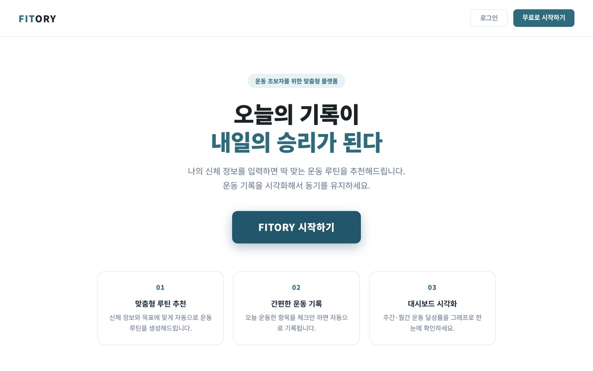
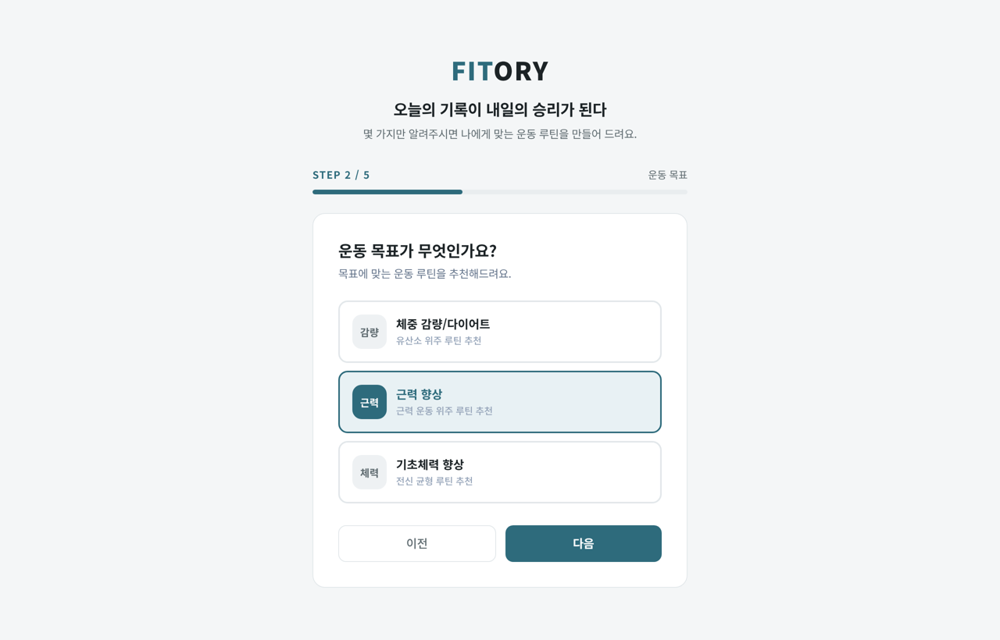
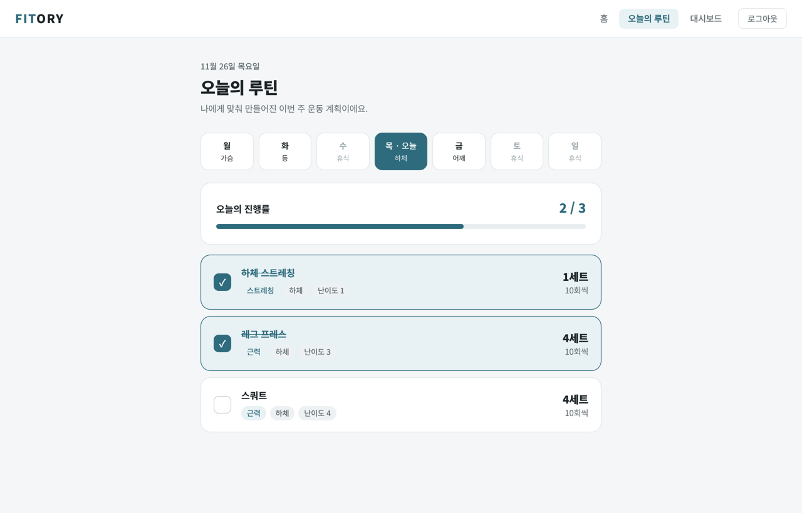
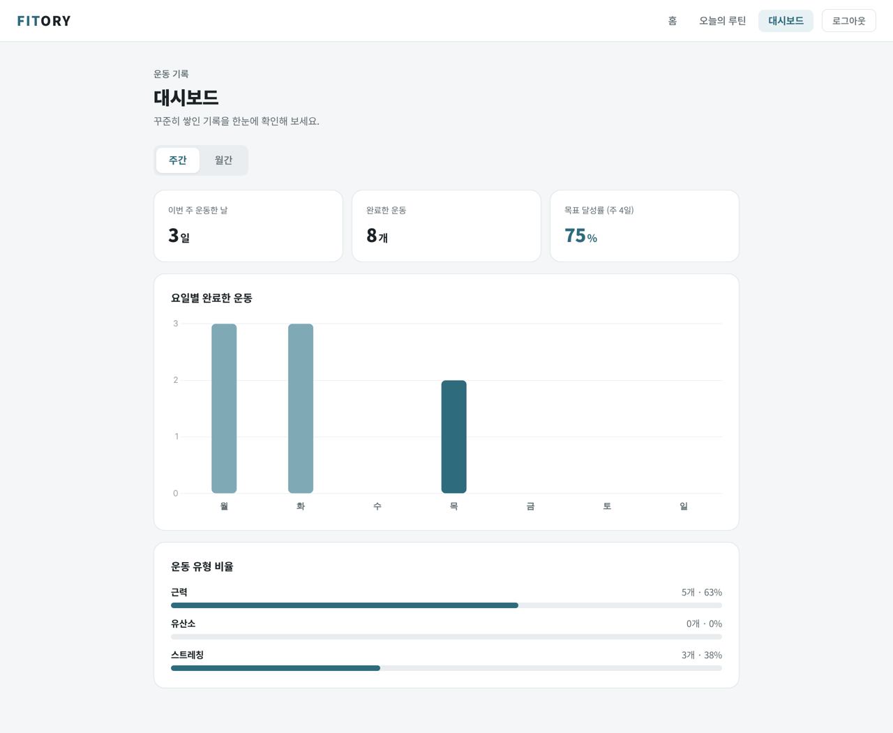
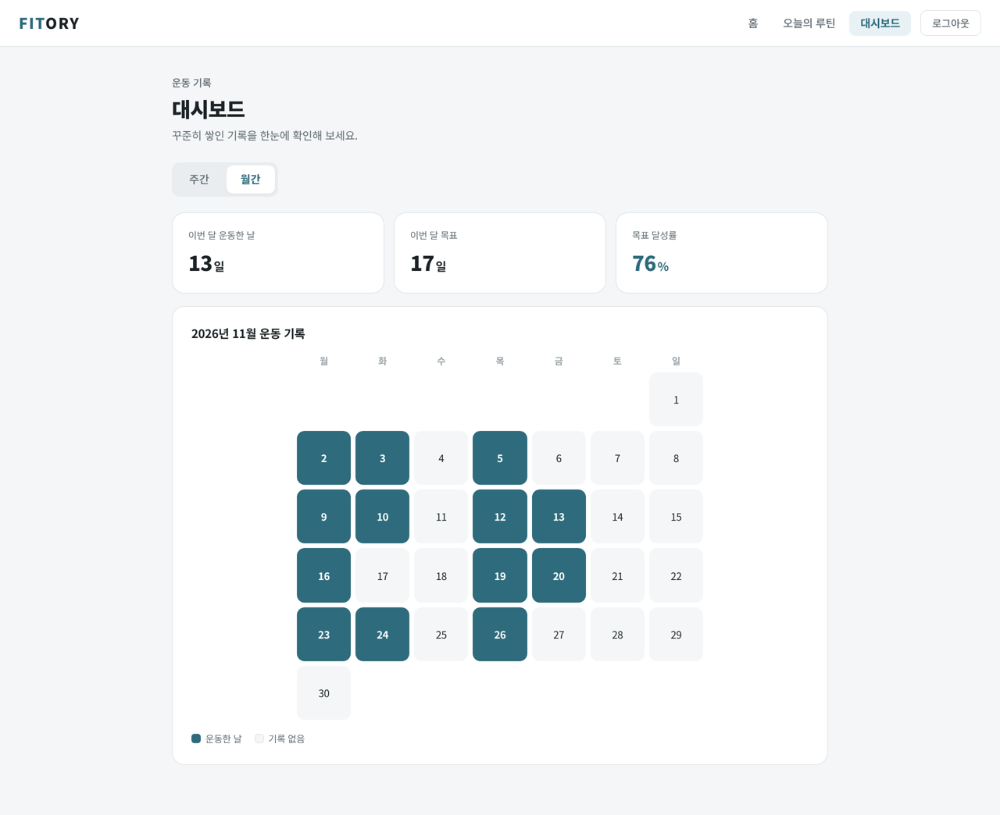
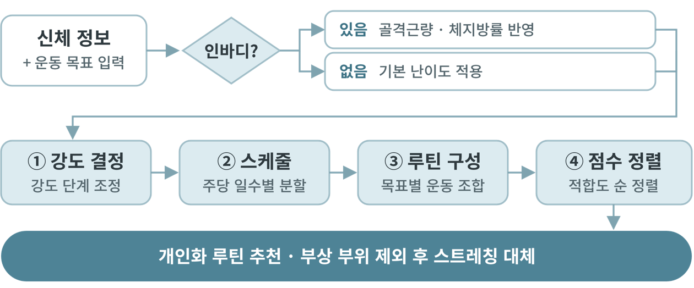

# FITORY

> **오늘의 기록이 내일의 승리가 된다**
> 초보자를 위한 개인화 피트니스 웹 플랫폼

FITORY는 **FIT + STORY**, **FITNESS + VICTORY**를 합친 이름입니다. 운동 기록이 쌓여 나만의 승리 이야기가 된다는 뜻을 담았습니다.

신체 정보와 운동 목표만 입력하면 요일별 맞춤 루틴을 바로 만들어 주고, 오늘의 루틴을 체크하면 기록이 쌓여 대시보드에서 성과를 확인할 수 있습니다.

<p align="center">
  
</p>

## 목차

- [만든 이유](#만든-이유)
- [주요 기능](#주요-기능)
- [화면](#화면)
- [추천 알고리즘](#추천-알고리즘)
- [시스템 구조와 기술 스택](#시스템-구조와-기술-스택)
- [API](#api)
- [실행 방법](#실행-방법)
- [테스트](#테스트)
- [폴더 구조](#폴더-구조)
- [팀](#팀)

## 만든 이유

유료 운동시설에 등록한 사람의 **71%가 한 달 안에 운동을 포기**합니다(한국건강증진개발원 설문조사). 주요 원인은 불규칙한 일정(36%), 동기 부여·의지 상실(30%), 그리고 무엇을 해야 할지 모른다는 점입니다.

FITORY는 운동 경험이 없는 초보자도 바로 따라 할 수 있는 맞춤 루틴과, 눈에 보이는 운동 기록으로 혼자서도 꾸준히 운동할 수 있도록 돕습니다.

## 주요 기능

| 기능 | 설명 |
|---|---|
| **맞춤 루틴 자동 생성** | 키·몸무게·운동 목표·주간 운동 횟수를 입력하면 요일별 운동 부위와 세트·횟수가 정해진 주간 루틴을 바로 만듭니다. 인바디(체지방률·골격근량)가 있으면 난이도를 더 세밀하게 조정합니다. |
| **오늘의 루틴과 운동 기록** | 오늘 할 운동을 확인하고, 완료 체크를 하면 운동 기록이 자동으로 저장됩니다. |
| **대시보드** | 이번 주에 운동한 날, 완료한 운동 수, 목표 달성률, 운동 유형 비율과 월간 달력을 보여 줍니다. |
| **회원 인증** | 회원가입·로그인 시 JWT 토큰을 발급하고, 이후 모든 요청을 토큰으로 인증합니다. |

## 화면

| 온보딩 | 오늘의 루틴 |
|---|---|
|  |  |
| 신체 정보, 목표, 주간 횟수, 인바디 여부를 5단계로 입력합니다. | 요일별 운동 부위를 보고, 오늘 운동을 체크하면 기록됩니다. |

| 대시보드 (주간) | 대시보드 (월간) |
|---|---|
|  |  |
| 요일별 완료한 운동, 목표 달성률, 운동 유형 비율 | 이번 달 운동한 날을 달력으로 확인 |

> 화면의 운동 기록은 예시 데이터입니다.

## 추천 알고리즘

초기 사용자 데이터가 없어도 바로 추천할 수 있고, 추천 이유를 설명할 수 있도록 **규칙 기반(Rule-Based)** 알고리즘을 사용합니다.

<p align="center">
  
</p>

1. **강도 결정**: 인바디가 있으면 골격근량·체지방률로 난이도를 조정하고, 없으면 기본 난이도를 사용합니다.
2. **스케줄**: 주간 운동 횟수에 맞춰 운동 요일과 부위를 나눕니다. (예: 주 3회 → 월 가슴, 수 등, 금 하체)
3. **루틴 구성**: 목표(다이어트·근력 향상·기초체력)에 따라 유산소와 근력 운동을 조합합니다. 매일 첫 운동은 스트레칭입니다.
4. **점수 정렬**: 근육 부위 일치 +100점, 난이도 일치 +40점, 난이도 1단계 차이 +20점으로 운동을 고릅니다.
5. **부상 회피**: 피하고 싶은 부위가 있으면 그 날은 근력 운동 대신 스트레칭으로 대체합니다.

## 시스템 구조와 기술 스택

```
[React (Vite)] --(/api, JWT)--> [Spring Boot] --(JPA)--> [H2 / MySQL]
```

| 구분 | 사용 기술 |
|---|---|
| Frontend | React 18, Vite, Axios, Chart.js, React Router |
| Backend | Java 17, Spring Boot 3.3, Spring Security, JWT, Spring Data JPA (Hibernate) |
| Database | H2 In-Memory (개발·테스트), MySQL (운영용 설정 준비) |
| Test | JUnit 5, MockMvc |
| Design / 협업 | Figma, GitHub |

프론트엔드는 Vite 개발 서버의 프록시로 `/api` 요청을 백엔드(`localhost:8080`)에 전달합니다.

## API

로그인 이후 요청은 `Authorization: Bearer <token>` 헤더가 필요합니다.

| 메서드 | 경로 | 설명 |
|---|---|---|
| POST | `/auth/signup` | 회원가입 |
| POST | `/auth/login` | 로그인, JWT 발급 |
| POST | `/body-info` | 신체 정보 저장 + 맞춤 루틴 자동 생성 |
| GET | `/routines/recommend?userId={id}` | 주간 루틴 조회 |
| POST | `/routines/recommend-and-save` | 루틴 생성·저장 |
| POST | `/workout-logs` | 운동 기록 저장 |
| DELETE | `/workout-logs/{logID}` | 운동 기록 삭제 |
| GET | `/workout-logs/weekly/{userID}` | 최근 7일 기록과 요약 |
| GET | `/workout-logs/monthly/{userID}` | 최근 30일 기록과 요약 |

## 실행 방법

### 준비물

- Java 17 (Java 23 이상은 Lombok 문제로 빌드되지 않습니다)
- Maven
- Node.js 18 이상

### 1. 백엔드

```bash
cd backend/routine-recommend-service
mvn spring-boot:run
```

- `http://localhost:8080`에서 실행됩니다. 로그에 `Started App`이 나오면 성공입니다.
- H2 메모리 DB를 사용해서 **서버를 다시 켜면 데이터가 초기화**됩니다. 운동 종목 30개는 `data.sql`로 자동 입력됩니다.
- DB 확인: `http://localhost:8080/h2-console` (JDBC URL `jdbc:h2:mem:fitnessdb`, User `sa`, 비밀번호 없음)

macOS에 Java가 여러 버전 있다면 먼저 17을 지정하세요.

```bash
export JAVA_HOME=$(/usr/libexec/java_home -v 17)
```

### 2. 프론트엔드

```bash
cd frontend/fitness-frontend
npm install
npm run dev
```

`http://localhost:5173`에 접속합니다.

### 3. 사용해 보기

1. 회원가입 (아이디 4~20자, 비밀번호 8자 이상)
2. 온보딩에서 키·몸무게·목표·주간 운동 횟수 입력
3. 오늘의 루틴에서 운동 완료 체크
4. 대시보드에서 기록 확인

## 테스트

```bash
cd backend/routine-recommend-service
mvn test
```

회원가입·로그인, 신체 정보 저장, 루틴 자동 생성, 트랜잭션 처리를 검증하는 테스트 **28개가 모두 통과**합니다.

## 폴더 구조

```
grad-project-personal-fitness
├── backend/routine-recommend-service
│   └── src/main/java/com/fitness
│       ├── controller   # Auth, BodyInfo, Routine API
│       ├── service      # 루틴 추천(RoutineRecommender), 운동 기록, 인증
│       ├── model        # 엔티티 (User, BodyInfo, Exercise, WorkoutLog ...)
│       ├── dto          # 요청·응답 형식
│       ├── security     # JWT 필터, Spring Security 설정
│       └── exception    # 공통 에러 응답
├── frontend/fitness-frontend
│   └── src
│       ├── api          # axios 설정, FITORY API 모듈
│       ├── pages        # 랜딩, 로그인, 회원가입, 온보딩, 홈, 루틴, 대시보드
│       ├── components   # 내비게이션, 로그인 보호 라우트
│       └── context      # 로그인 상태
└── docs/images          # README 이미지
```

## 팀

홍익대학교 컴퓨터공학과 2026 졸업프로젝트 · 지도교수 이장호 교수님

| 이름 | 역할 |
|---|---|
| 원세빈 | Frontend |
| 김윤섭 | Backend |
| 이유나 | Backend |
